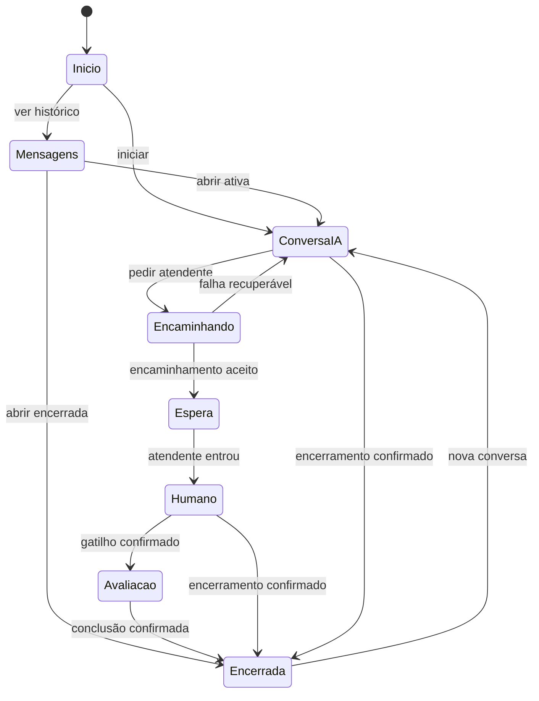

# Experiência e brainstorming orientado

## Ideia central

Um atendimento oficial, claro e contínuo. A pessoa conversa com uma instituição e precisa reconhecer quando a IA responde, quando aguarda a equipe e quando alguém assume. O núcleo é a conversa; início e histórico ajudam a chegar até ela.

## Alternativas para o Claude explorar

| Direção | Composição | Vantagem | Risco | Encaminhamento |
|---|---|---|---|---|
| A · Conversa em primeiro plano | Início enxuto com CTA, retomada e exemplos contextuais; conversa ocupa área útil | Reduz atrito e dá foco | Esconder histórico ou humano em ícones | Direção preferencial com rótulos claros |
| B · Central de atendimento | Início com mais organização por assunto e cartões | Ajuda quem não sabe perguntar | Vira portal e inventa catálogo de serviços | Só usar categorias comprovadas; evitar como padrão |

O Claude deve comparar as duas em esboços próprios no código ou descrição curta, escolher e desenvolver uma. Não precisa produzir duas aplicações completas. Não mudar a entrada atual para conversa direta sem registrar a proposta de navegação.

## Hierarquia de ações

| Estado | Ação principal | Ações de apoio |
|---|---|---|
| Início | Iniciar conversa | Retomar recente; mensagens |
| Mensagens/histórico | Abrir conversa | Nova conversa; voltar |
| Conversa IA | Escrever/enviar | Anexar; áudio; atendimento humano; histórico |
| Encaminhamento/espera | Entender o estado e continuar conforme contrato | Histórico e retorno sem perder conversa |
| Humano | Continuar a mesma conversa | Anexo/áudio conforme suporte real |
| Encerrada | Ler ou iniciar nova conversa | Histórico |
| Falha no envio | Tentar novamente | Editar/copiar texto, se aplicável |

## Fluxo de atendimento proposto

Esta máquina é uma proposta de modelagem. O print mostra a transferência e o resultado, não o estado de fila ao vivo. Avaliação e encerramento seguem eventos do backend, não temporizadores visuais. Reabertura da conversa encerrada não está autorizada; nova conversa tem novo ID.

## Continuidade e orientação

- Um acesso ao histórico dentro da conversa e uma lista principal podem coexistir usando a mesma fonte de dados. Não renderizar listas contraditórias.
- Título deve ajudar a reconhecer o assunto. Preferir assunto do atendimento se o backend o fornecer; caso contrário, derivar localmente do primeiro texto apenas para demonstração. Não criar nova chamada de IA para nomear chats.
- Abertura do histórico preserva conversa e rascunho. Ação nova conversa não deve apagar a anterior nem criar entradas vazias repetidas sem necessidade. Definir momento de criação com TI.
- “Fechar” significa fechar a interface; não encerrar atendimento. Voltar no app segue o shell/histórico definido; não apagar rascunho nem sair do aplicativo por acidente.
- Acesso humano deve ser encontrável sem precisar saber uma frase secreta. O controle pode aparecer como ação contextual clara. A disponibilidade real controla a mensagem.
- Troca de IA para humano precisa de nome/papel e evento textual persistente na conversa. Aviso de IA muda de contexto quando o atendente assume.
- Escrever novamente enquanto aguarda a equipe deve seguir o contrato. Não cancelar encaminhamento nem devolver para IA por conta própria.

## Ideias que ficam fora da primeira versão

Personalização preditiva, alertas acadêmicos proativos, busca inteligente global, favoritos, apagar/renomear/exportar chats, reações novas, chamada de voz ao vivo, transcrição automática, múltiplos modelos e agentes especializados. São possibilidades de produto, não requisitos descobertos. Só entrar com decisão explícita e dependências claras.
