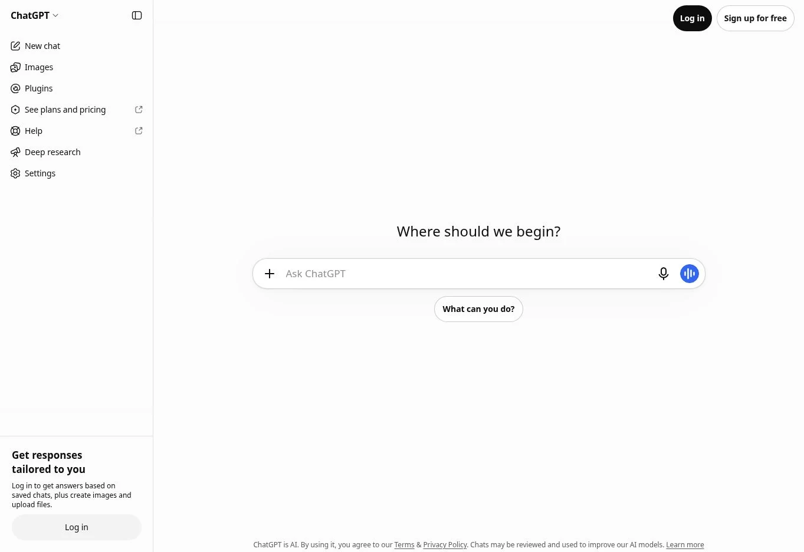
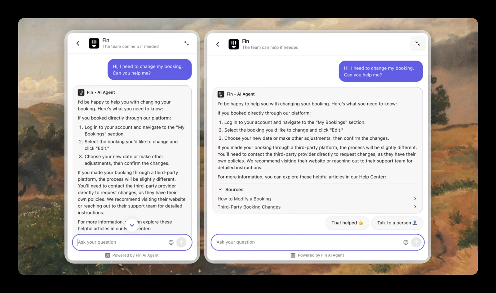
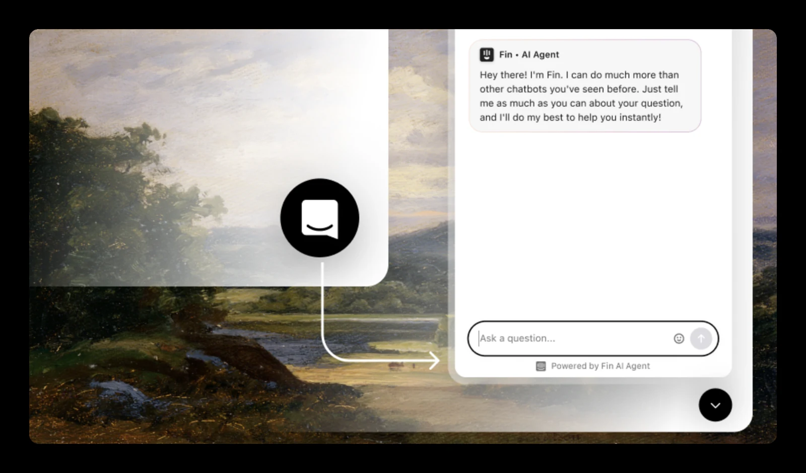

# Curadoria comentada — poucas referências, cada uma com função

Pesquisa e observação em 09/11/2026. Duas referências principais: **ChatGPT** e **Intercom/Fin**. Um vídeo oficial do Claude fica como complemento, sem ampliar escopo. Nenhuma imagem de resultado foi gerada por IA.

## R01 · ChatGPT — hierarquia da conversa

[Interface pública observada](https://chatgpt.com/). Captura local: [chatgpt-inicio.webp](products/chatgpt-inicio.webp).

A captura mostra início sem login: sidebar discreta, área de leitura limpa e composer reconhecível com ações agrupadas. Aplicar a prioridade dada ao texto e o espaço útil. Não copiar navegação de planos, modelos, imagens, plugins ou funcionalidades de geração. Histórico autenticado, app móvel e timing de animações **não foram inspecionados**. Referência visual não implica usar OpenAI como backend.

## R02 · Intercom/Fin — suporte híbrido e messenger

[Documentação oficial](https://www.intercom.com/help/en/articles/9319961-updates-to-the-messenger). Arquivos baixados de imagens publicadas nesse artigo; são exemplos de produto do fornecedor, não capturas de uma sessão Anchieta.

A comparação mostra como ampliar a conversa melhora a leitura, preservando identidade e composer. Aplicar continuidade entre tamanhos e acesso compreensível a uma pessoa. O artigo documenta identificação e handover para equipe humana: usar esse princípio, sem adotar suas regras de fila ou suas funcionalidades como fatos do Anchieta.

Esta segunda imagem é **entrada direta na conversa**, não evidência de uma transferência. Ajuda a comparar com o início atual. Não remover o início do Anchieta automaticamente; manter caminho de histórico e retomada.

Não copiar paisagem de fundo, roxo ou branding Fin. Adaptar o padrão à identidade e à estrutura real do Anchieta.

## R03 · Claude — complemento audiovisual limitado

Ver [videos/README.md](videos/README.md). Página pública de login foi inspecionada, mas não oferece evidência de chat autenticado. Imagens promocionais sem interface útil foram descartadas. O material de artifacts não entra como direção funcional de chatbot.

## Pinterest — tentativa e limite

[Busca aberta no navegador](https://www.pinterest.com/search/pins/?q=AI%20chat%20interface%20design). A página exibiu miniaturas e uma modal exigindo login para aprofundar. Não houve login, seleção de pin individual, download de peças ou atribuição de autor. Portanto, **nenhum pin foi promovido a referência validada**. A busca fica como trilha opcional, não como moodboard aprovado. Não atribuir a um criador um visual que não foi aberto/verificado.

## Como usar esta pasta

Olhar imagens, ler anotações e identificar o princípio útil. Em seguida, voltar ao inventário do Anchieta. Referências não são especificação de backend, prova de acessibilidade ou licença para reaproveitar ativos. Material de terceiros é de seus respectivos titulares e fica aqui para análise/revisão; não embutir em bundle público do aluno. Nenhuma licença desses ativos foi verificada.
