# Evidências atuais — 20 prints fornecidos

Capturas de 09/11/2026. Desktop recortado para remover contexto acadêmico e RA do portal. Fotos pessoais em mensagens foram cobertas. Nome próprio comum e conteúdo do chat permanecem como evidência; não são fixtures de produção. Duas capturas móveis repetem estados e estão indicadas. Não há vídeo do legado.

## S01 · Início compacto, recente, CTA e navegação.

Origem: `image(20261109-201813).png`.

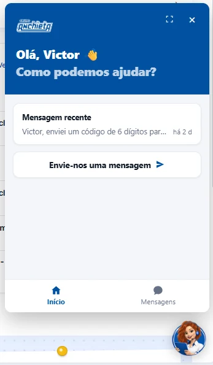

## S02 · Mesmo início em painel expandido.

Origem: `image(20261109-201829).png`.

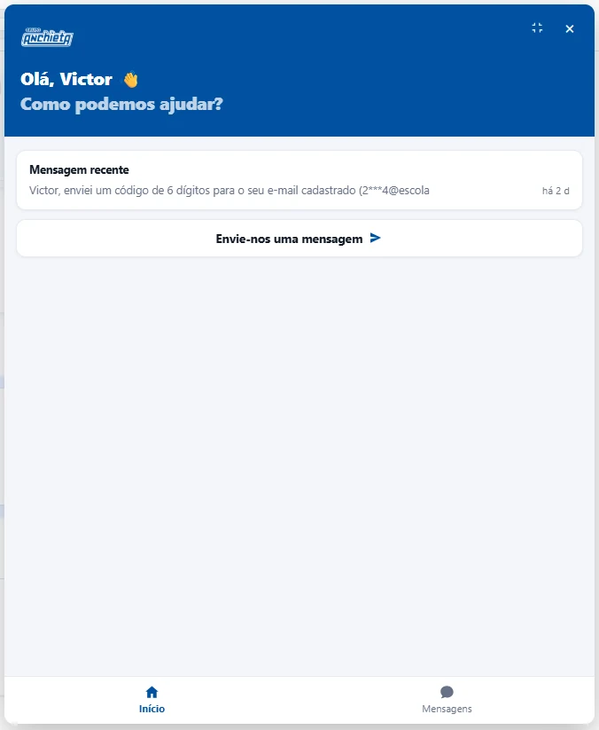

## S03 · Lista de atendimentos, status e datas.

Origem: `image(20261109-201837).png`.

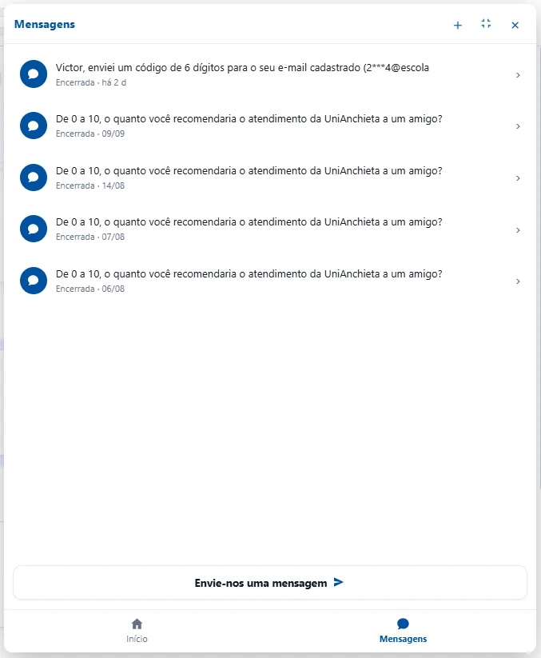

## S04 · Lista compacta e ação de nova conversa.

Origem: `image(20261109-201843).png`.

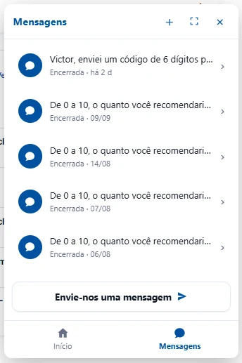

## S05 · Conversa encerrada, somente leitura e nova conversa.

Origem: `image(20261109-201856).png`.

## S06 · Histórico: transferência, humano, escala 0–10 e encerramento.

Origem: `image(20261109-201901).png`.

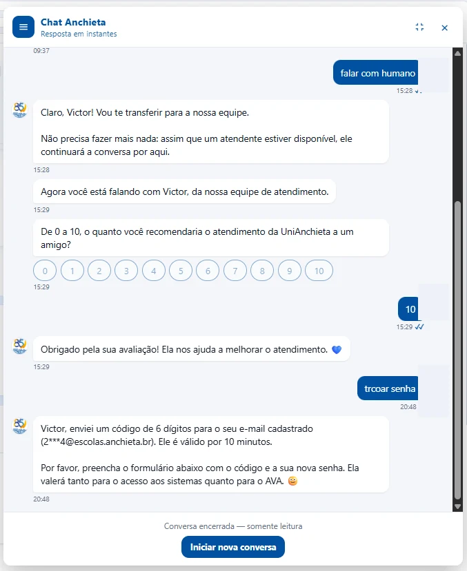

## S07 · Drawer sobre conversa selecionada.

Origem: `image(20261109-201917).png`.

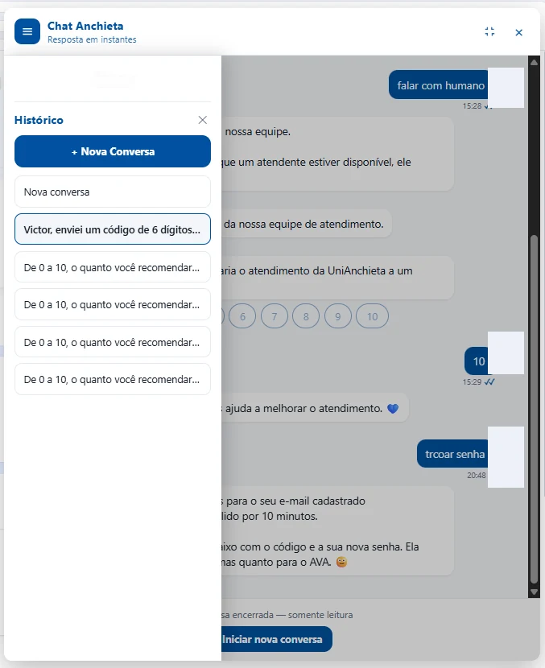

## S08 · Drawer no painel compacto.

Origem: `image(20261109-201925).png`.

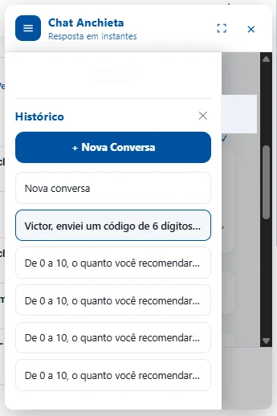

## S09 · Conversa vazia e composer.

Origem: `image(20261109-201934).png`.

## S10 · Conversa vazia expandida.

Origem: `image(20261109-201940).png`.

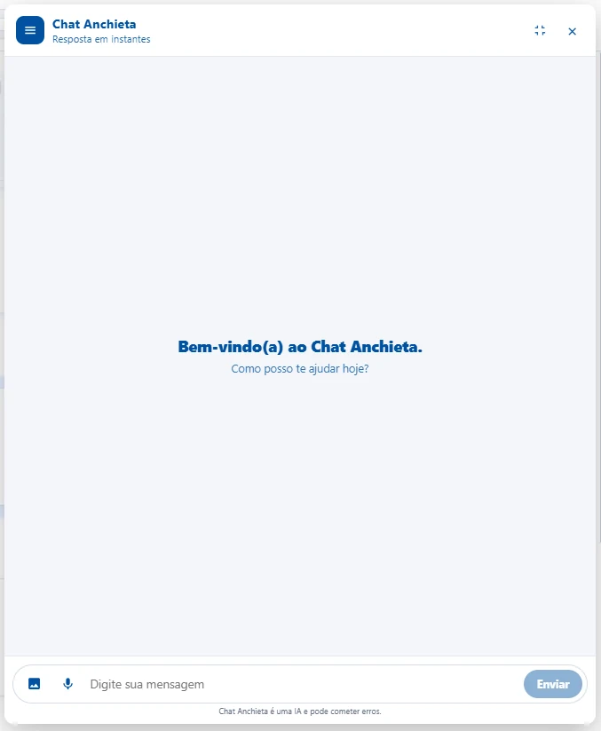

## S11 · Página embutida escura, sugestões e trocar tipo de dúvida.

Origem: `image(20261109-202002).png`.

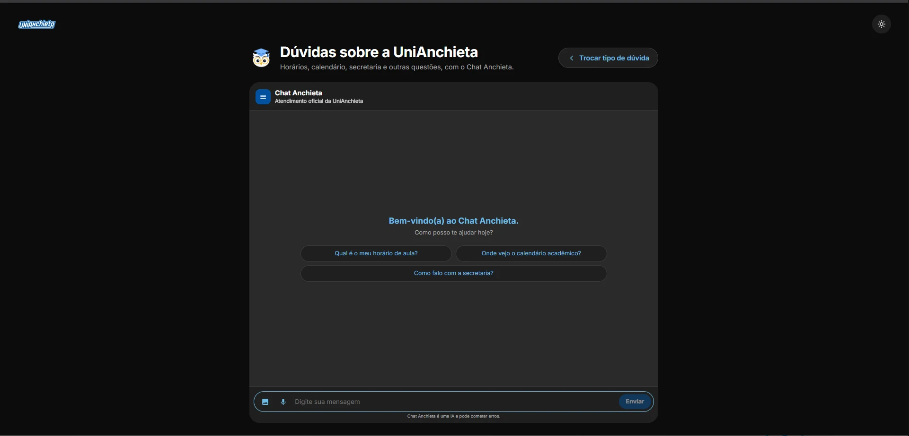

## S12 · Histórico sobreposto no app, tema escuro.

Origem: `image(20261109-202224).png`.

## S13 · Permissão nativa iOS; não comprova gravação/transcrição.

Origem: `image(20261109-202240).png`.

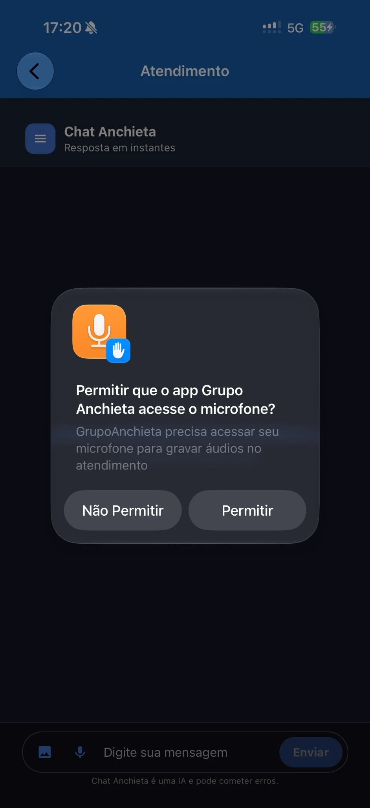

## S14 · Composer com teclado aberto.

Origem: `image(20261109-202246).png`.

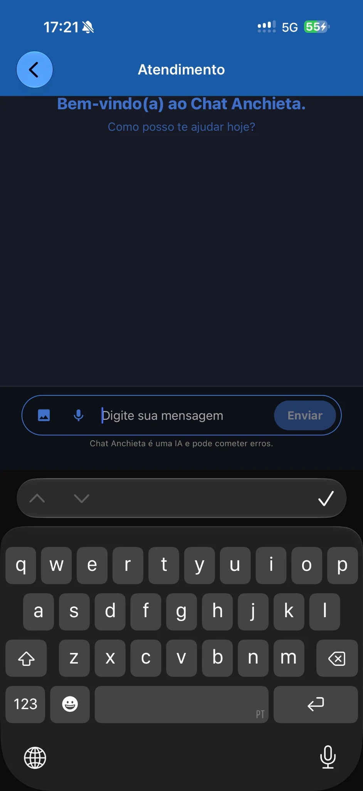

## S15 · Segundo registro do drawer; variante equivalente.

Origem: `image(20261109-202255).png`.

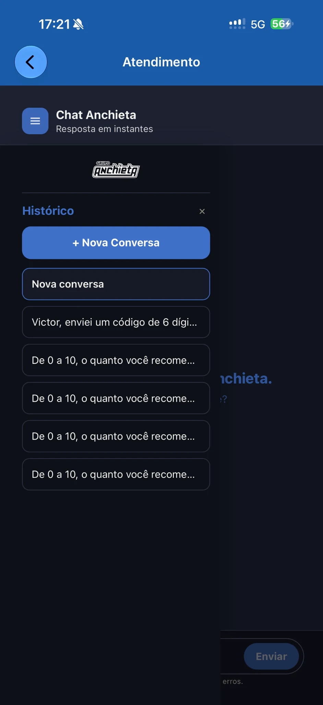

## S16 · Segundo registro do teclado; variante equivalente.

Origem: `image(20261109-202300).png`.

## S17 · Opções nativas de fotos/câmera/arquivo.

Origem: `image(20261109-202312).png`.

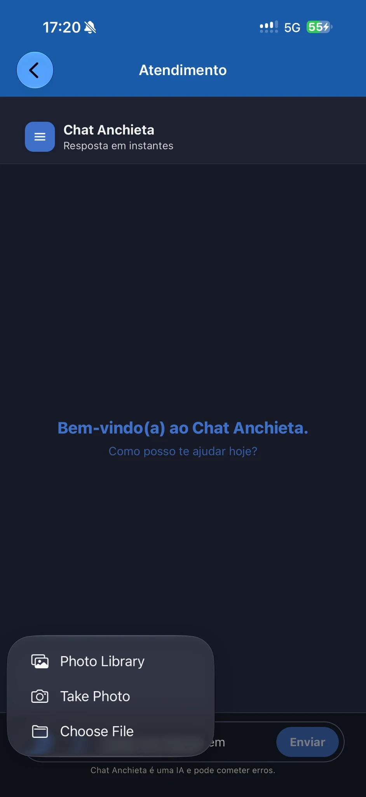

## S18 · Lista, status encerrado, datas e navegação.

Origem: `image(20261109-202324).png`.

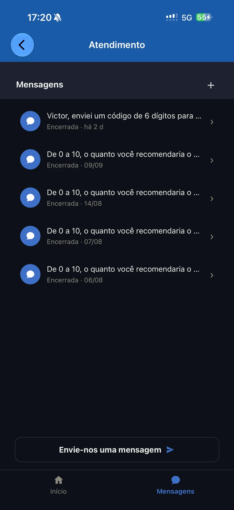

## S19 · Escala 0–10, conteúdo e encerramento.

Origem: `image(20261109-202332).png`.

## S20 · Saudação, recente e ação de mensagem.

Origem: `image(20261109-202342).png`.

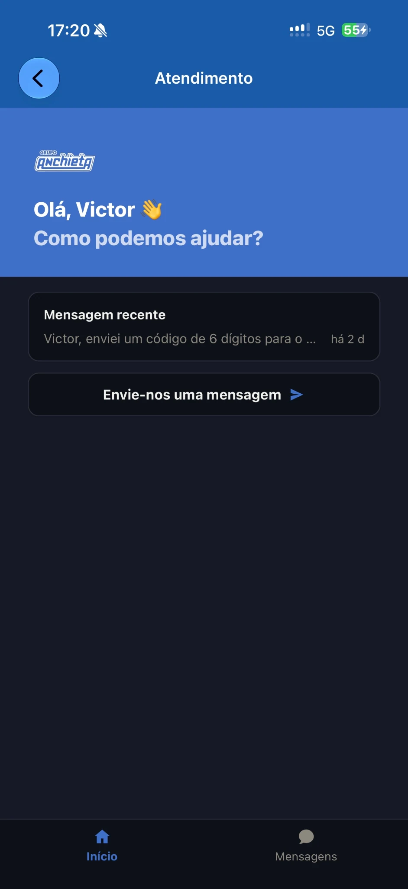
